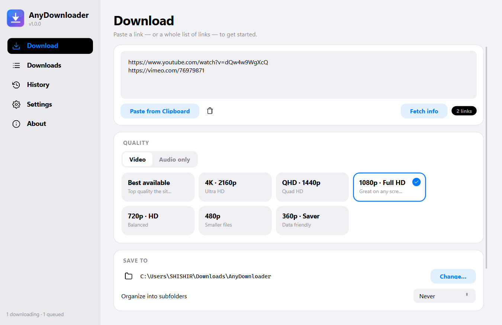
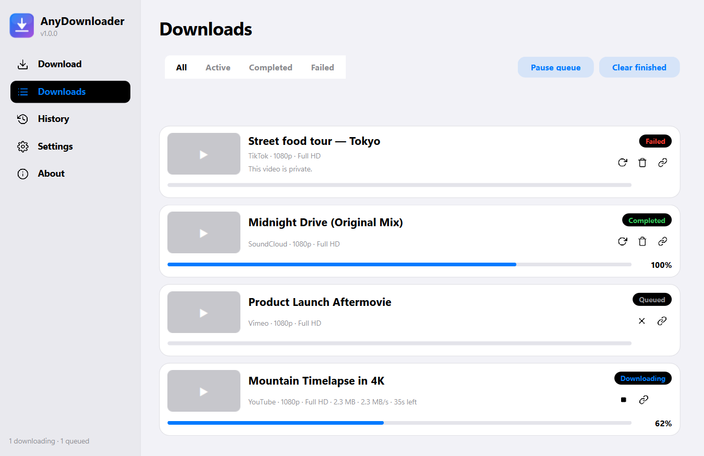
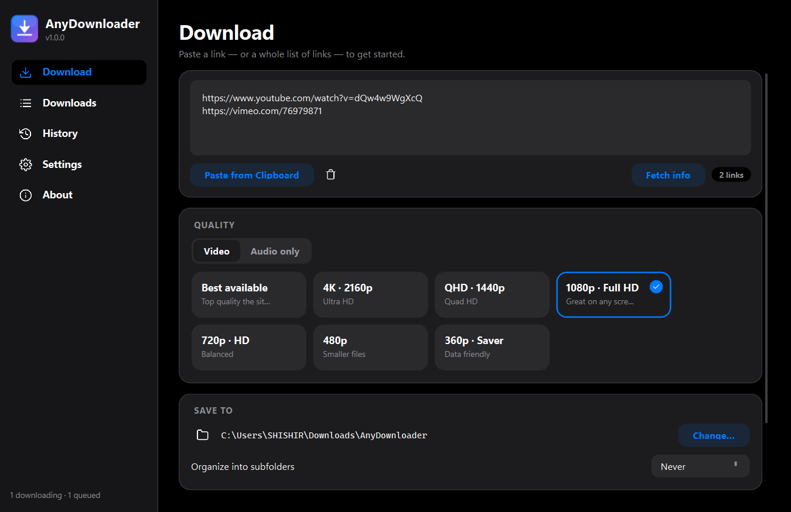
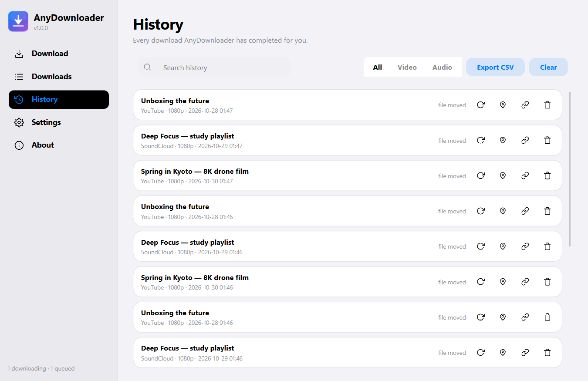

<p align="center">
  
</p>

<h1 align="center">AnyDownloader</h1>

<p align="center">
  <b>Download video & audio from (almost) anywhere — wrapped in a beautiful, Apple-style desktop app.</b><br/>
  Powered by <a href="https://github.com/yt-dlp/yt-dlp">yt-dlp</a>. No servers. No accounts. No nonsense.
</p>

<p align="center">
  
  
  
  
  
</p>

---

AnyDownloader is a **standalone Windows desktop application** for downloading video and audio from YouTube, Vimeo, TikTok, SoundCloud, Twitter/X, Instagram, Reddit, Dailymotion, Twitch, and **1000+ other sites** via the yt-dlp engine. Install it with a classic setup wizard, or run the portable exe — and pair it with the **browser extension** to send videos from any page with one click.

It runs **entirely on your machine** — yt-dlp is embedded as a library (not shelled out to a script), FFmpeg ships inside the app, and nothing is ever uploaded or sent to any server.

## ✨ Highlights

| | |
|---|---|
| 🎨 **iOS-inspired UI** | Light & dark themes, 9 accent colours, system-theme following, smooth spring-style animations everywhere |
| 🎯 **Quality presets** | Best available, 4K, 1440p, 1080p, 720p, 480p, 360p — or audio-only: MP3, M4A, Opus, FLAC, WAV |
| 📋 **Single & batch** | Paste one link or a hundred — AnyDownloader extracts every URL from messy text automatically |
| 🔍 **Link preview** | "Fetch info" shows the title, channel, duration, thumbnail and available qualities before you commit |
| 🧠 **Smart queue** | Concurrency control, pause/resume, per-item retry, live speed & ETA, taskbar progress, tray notifications |
| ⚙️ **Advanced options** | Filename templates, subfolder organisation, container choice (MP4/MKV/WebM), subtitles (embed or sidecar), SponsorBlock, download archive, proxy, cookies, speed limits |
| 🧩 **Browser extension** | Chrome/Edge companion: send the current page or detected media files to the app, pick quality in the popup, launch the app if it's closed |
| 🗂 **History** | Every finished download remembered, searchable, re-downloadable, CSV-exportable |
| 🔒 **Local-first** | No telemetry. All data in `%LOCALAPPDATA%\AnyDownloader`. |

## 📸 Screenshots

| Download | Queue |
|---|---|
|  |  |

| Dark mode | History |
|---|---|
|  |  |

## 🚀 Getting started

### Option A — run the installer (recommended)

1. Grab `AnyDownloader-Setup-x.y.z.exe` from the [latest release](../../releases/latest).
2. Run it — Python, yt-dlp and FFmpeg are **already inside**. You get Start-menu & desktop shortcuts, an entry under *Apps & features*, and the `anydownloader://` link protocol (needed by the extension when the app is closed).
3. Windows SmartScreen may ask for confirmation on first run (unsigned binary) — click *More info → Run anyway*.

### Option B — portable exe

Prefer no install? Download `AnyDownloader-vX.Y.Z-windows-x64.exe` from the same release and just run it. Everything is inside the single file; only the `anydownloader://` protocol and Start-menu shortcuts are missing.

### Option C — run from source

```bash
git clone https://github.com/Shishir-ip/AnyDownloader.git
cd AnyDownloader
pip install -e .
python -m anydownloader
```

### Option D — build everything yourself

```bash
pip install -e . pyinstaller
python scripts/prepare_ffmpeg.py          # fetches ffprobe for bundling
pyinstaller AnyDownloader.spec --noconfirm          # → build/dist/AnyDownloader.exe
ISCC installer/AnyDownloader.iss                    # → build/installer/…-Setup.exe  (Inno Setup 7)
```

> **Tip:** run `pytest` to execute the 122-test suite (fully offline).

## 🧭 Using the app

1. **Paste** a link (or many) into the box — or use *Paste from Clipboard*, which pulls every URL out of copied text.
2. **Pick a quality** — video presets or audio-only formats.
3. *(Optional)* expand **Advanced options** for playlists, subtitles, SponsorBlock, proxies, cookies and more.
4. Hit **Download Now** (or *Add to Queue* to batch up) and watch the live progress.

**Keyboard shortcuts:** `Ctrl+1…5` switch pages · `Ctrl+V` paste links · `Ctrl+Enter` start download · `Ctrl+,` settings

## 🧩 Browser extension (Chrome / Edge / Brave)

The companion extension lives in [`extension/`](extension) (also installed to `C:\Program Files\AnyDownloader\browser-extension` by the setup).

**Install:** unzip it (or use the installed folder) → open `chrome://extensions` (or `edge://extensions`) → enable *Developer mode* → **Load unpacked** → select the folder.

**Use:**
- Click the AnyDownloader icon on any page → **Send this page** queues it in the app and it starts downloading immediately.
- Pick a **quality** in the popup first — Best / 4K / 1080p / 720p / 480p / 360p / MP3 / M4A / Opus (remembered).
- Pages with direct media files (mp4, webm, mp3, …) list each file with its own download button.
- App closed? One click on **Open AnyDownloader & download** launches it via the `anydownloader://` protocol and the download starts automatically.

**How it talks to the app:** a localhost-only bridge (`http://127.0.0.1:7272`, bound to 127.0.0.1, toggle in *Settings → Behaviour*). Nothing leaves your machine. Every accepted link is logged under `%LOCALAPPDATA%\AnyDownloader\logs\`.

## 📁 Where do my files go?

By default: `Downloads\AnyDownloader`. Change it on the Download page or in Settings. With *Organize into subfolders* enabled, files land in per-site (`youtube/…`) or per-type (`Video/…`, `Audio/…`) folders.

## 🛠 Troubleshooting

| Symptom | Fix |
|---|---|
| *"Age-restricted / private"* errors | Enable **Settings → Network → Cookies from browser** (Chrome/Edge/Firefox) or provide a `cookies.txt` |
| *"This website is not supported"* | Update the app — yt-dlp gains extractors weekly; check [releases](../../releases) |
| Slow downloads | Raise *Concurrent fragments* in Advanced options; check your proxy |
| Downloaded file missing | History page → *Show in folder*. If it says "file moved", it was deleted or renamed outside the app |
| Themed title bar wrong | Switch theme to Light/Dark explicitly in Settings |
| Extension says *app not running* | Start AnyDownloader (bridge is on by default), then click **Open AnyDownloader & download** in the popup |
| Extension sends but nothing happens | Close **all** app instances (check the tray!) and reopen — a stale instance may be holding the bridge port |
| Bridge port busy warning | Another process uses port 7272 — close it, or change `bridge_port` in `%LOCALAPPDATA%\AnyDownloader\settings.json` |

## 🏗 Project structure

```
anydownloader/
  core/        # engine (yt-dlp wrapper), manager, models, settings, history, bridge
  ui/          # theme system, custom widgets, pages, tray, taskbar, icons
extension/     # browser extension (MV3, Chrome/Edge)
installer/     # Inno Setup script for AnyDownloader-Setup.exe
assets/        # app icon & branding
docs/          # screenshots
scripts/       # dev tools: smoke test, icon/screenshot generators, ffprobe prep
tests/         # offline pytest suite (131 tests)
.github/       # CI: test + release builds
```

## 🤝 Contributing

Issues and PRs are welcome! Run `pytest` before submitting. Keep the code typed, logged and tested like the surrounding code.

## ⚖️ Legal

AnyDownloader is a UI wrapper around [yt-dlp](https://github.com/yt-dlp/yt-dlp) and is intended for downloading content you have the right to download (your own uploads, Creative Commons, or where the site permits). Respect copyright and each website's terms of service. The authors are not responsible for misuse.

## 📄 Licence

[MIT](LICENSE) — with bundled components under their own licences: yt-dlp (Unlicense), PySide6/Qt (LGPL-3), FFmpeg binary via imageio-ffmpeg (GPL).
